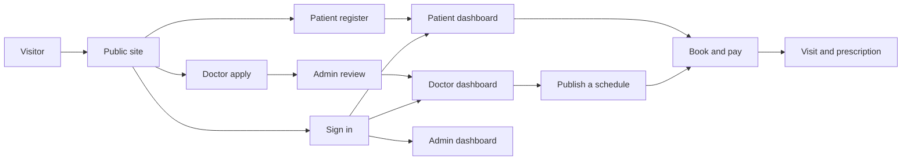
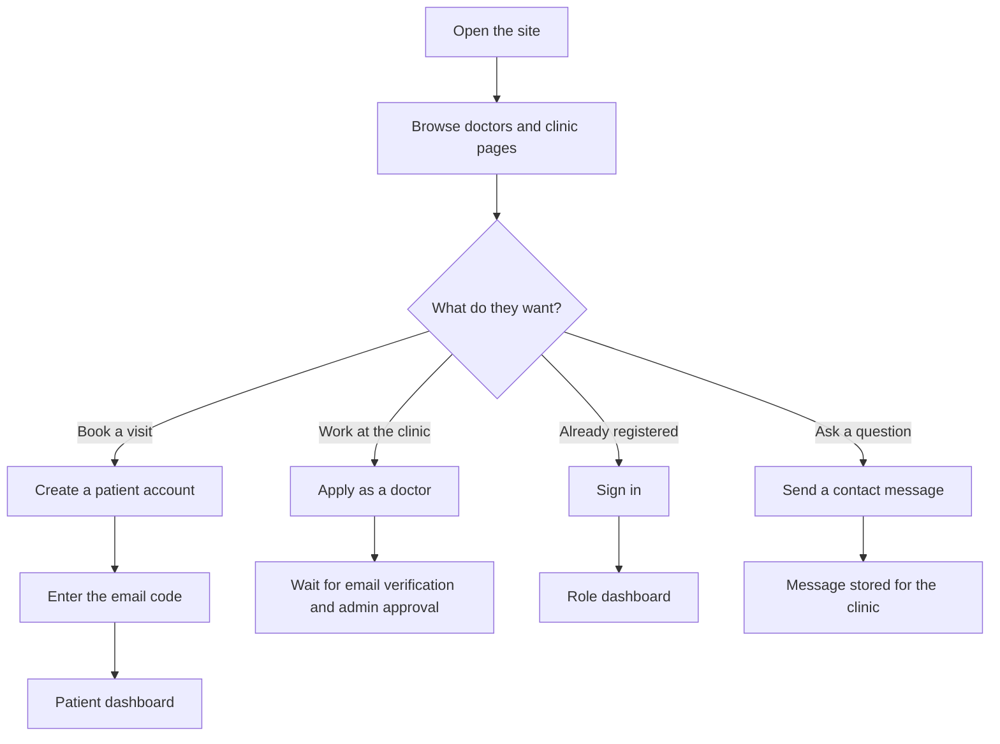
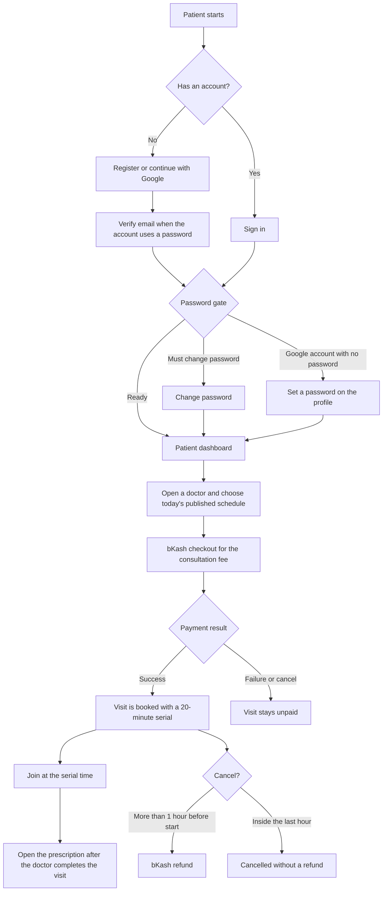
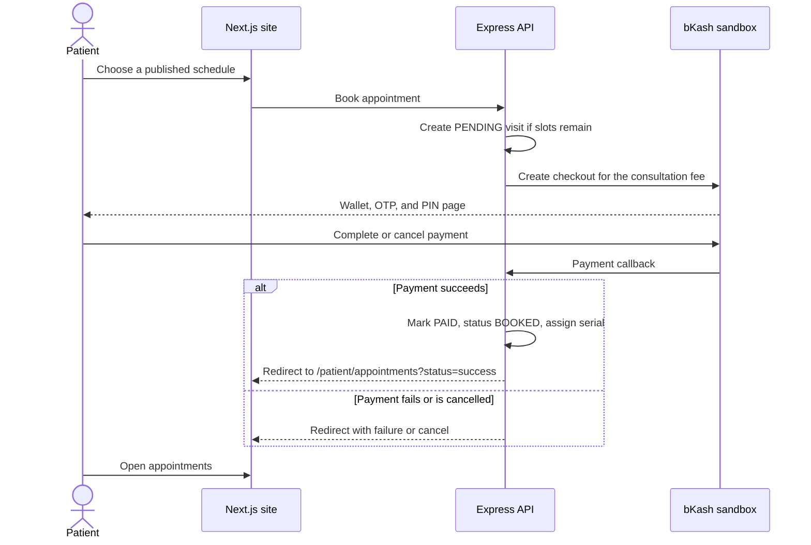
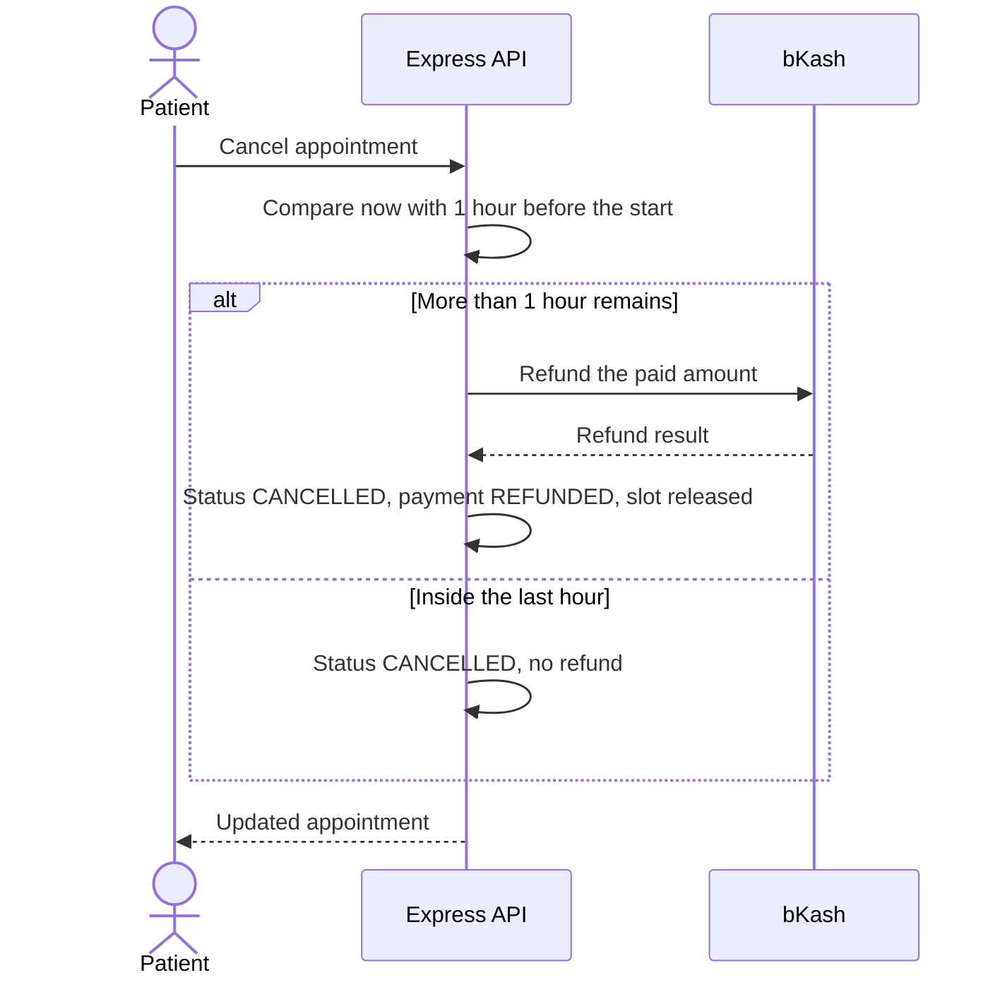
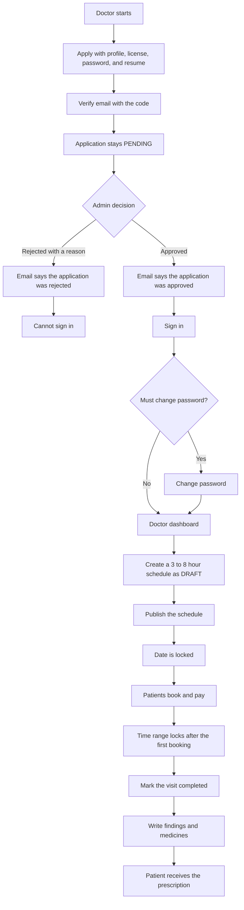
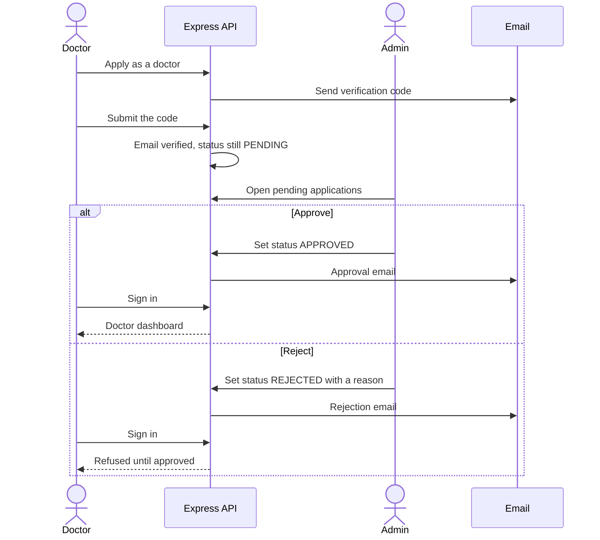
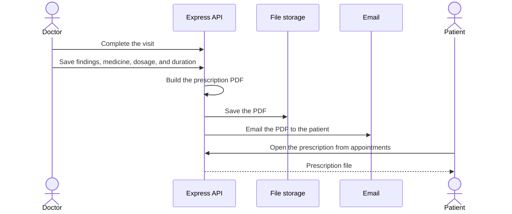
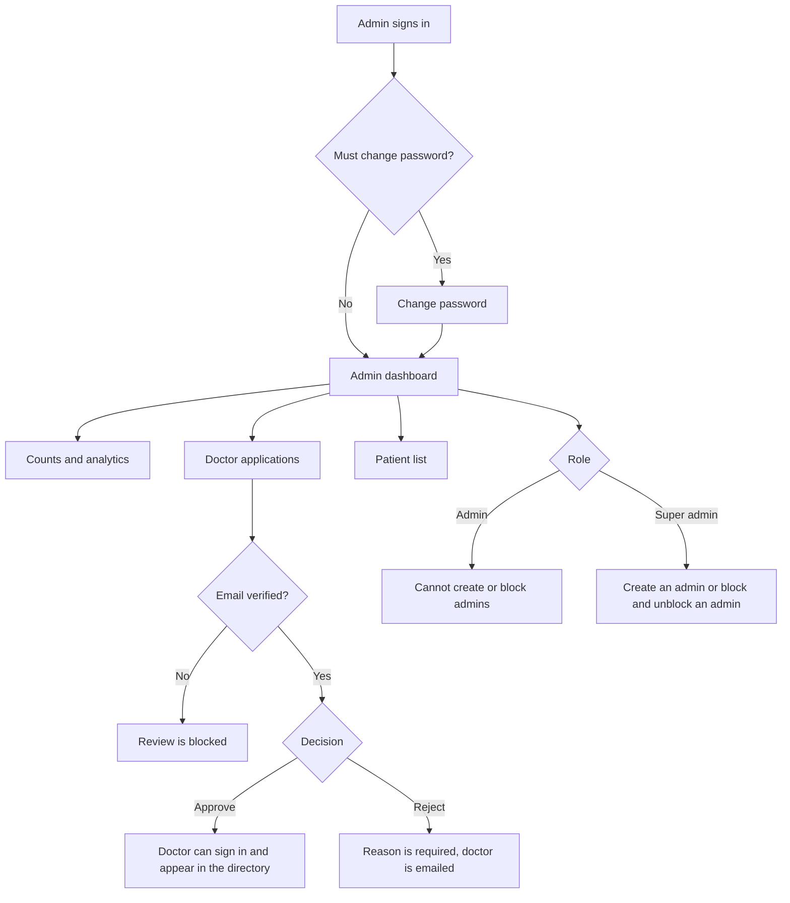
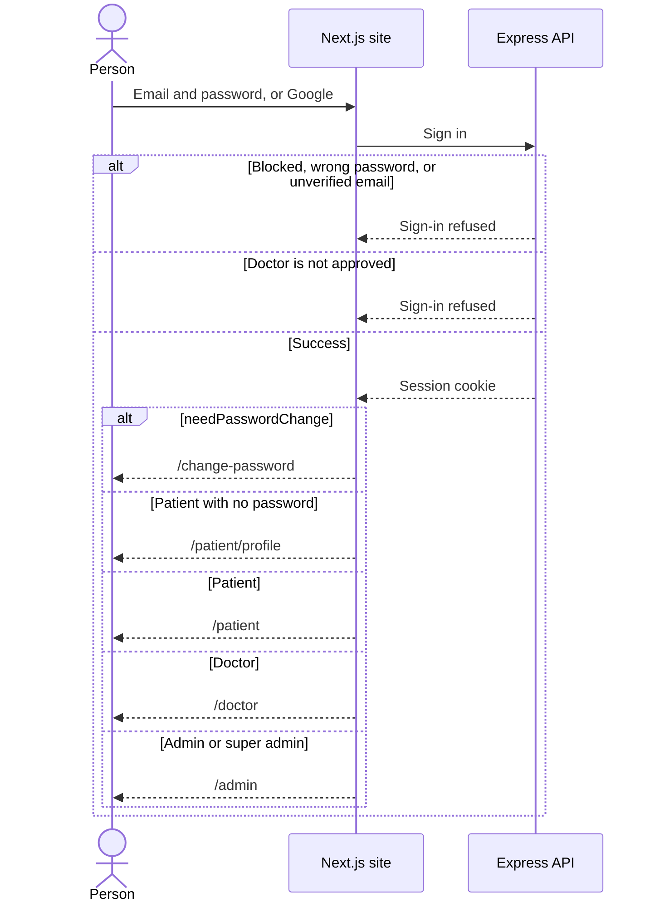

# PH Healthcare workflow

Site: https://ph-healthcare-six.vercel.app
API: https://ph-healthcare-api.vercel.app

This file describes how the live app behaves. The diagrams match the current Express API and Next.js pages.

Roles are `PATIENT`, `DOCTOR`, `ADMIN`, and `SUPER_ADMIN`. Admin and super admin share the `/admin` area. A super admin is the only role that can create another admin or block an admin.

Open this file in a Markdown viewer that renders Mermaid (GitHub, VS Code, or Cursor) to see the charts.

## Map of the product

## 1. Visitor flow

Anyone can read the public pages without an account: home, doctor directory, doctor details, about, journal, help, contact, privacy, and terms.

The directory lists only doctors who are approved, active, email-verified, and not deleted. Contact messages are not bookings.

## 2. Patient flow

A patient is the person who books a visit.

Sign-up paths:

- Email and password, then an email verification code.
- Google sign-in, which creates a patient account. If that account has no password, the next stop is the patient profile so a password can be set.

After login:

1. If `needPasswordChange` is true, the app opens `/change-password`.
2. If the role is patient and the account has no password, the app opens `/patient/profile`.
3. Otherwise a patient opens `/patient`.

Booking rules:

- The schedule must be published.
- Booking is allowed only on the same calendar day, and only before the schedule starts.
- The patient pays the doctor's consultation fee with bKash.
- A successful payment marks the visit `BOOKED` and assigns the next 20-minute serial.
- One patient cannot hold two active visits on the same schedule.
- Cancel more than 1 hour before the start time to receive a bKash refund. Later than that, the visit is cancelled with no refund.

### Patient booking sequence

### Cancel and refund sequence

## 3. Doctor flow

A doctor cannot sign in until both of these are true:

- The email is verified.
- An admin has approved the application.

Until then the public directory does not show that doctor.

Schedule rules:

- The window is 3 to 8 hours on one calendar date.
- Each paid visit takes the next open 20-minute serial inside that window.
- A draft can be edited freely.
- After publish, the date is locked.
- After the first booked visit, the time range is locked.
- The schedule needs a meeting link before patients can join.

After a completed visit, the doctor records findings and medicines. The API builds a prescription PDF, stores it, and emails it to the patient.

### Doctor approval sequence

### Prescription sequence

## 4. Admin flow

`ADMIN` and `SUPER_ADMIN` both land on `/admin` after login, unless a password change is required.

Shared work:

- Read clinic counts and the analytics page.
- Search and approve or reject doctor applications. A doctor must verify email before review. Rejection requires a reason.
- View patients.

Super admin only:

- Create an admin.
- Block or unblock an admin or super admin.

A blocked user cannot sign in.

### Sign-in sequence for every role

## Status words used in the API

| Record | Values | Meaning in the product |
| --- | --- | --- |
| Doctor verification | `PENDING`, `APPROVED`, `REJECTED` | Only `APPROVED` doctors can sign in and appear in the directory |
| Schedule | `DRAFT`, `PUBLISHED` | Patients can book only a published schedule |
| Appointment | `PENDING`, `BOOKED`, `CONFIRMED`, `ONGOING`, `COMPLETED`, `CANCELLED` | A new booking starts as `PENDING` and becomes `BOOKED` after payment |
| Payment | `UNPAID`, `PAID`, `FAILED`, `CANCELLED`, `REFUNDED` | The fee is collected and refunded through bKash |
| User | `ACTIVE`, `BLOCKED`, `DELETED` | A blocked user cannot sign in |

## Page each role opens

| Role | Home after sign-in | Main pages |
| --- | --- | --- |
| Patient | `/patient` | Book, appointments, payments, profile |
| Doctor | `/doctor` | Schedules, appointments, profile |
| Admin | `/admin` | Analytics, approve doctors, patients |
| Super admin | `/admin` | Same as admin, plus admins |
