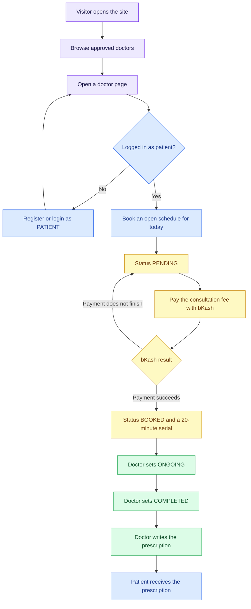
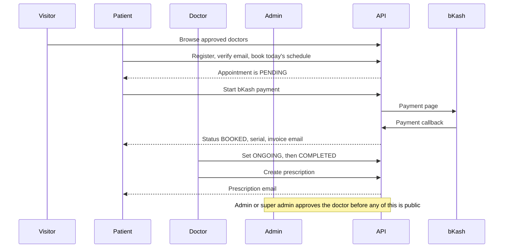
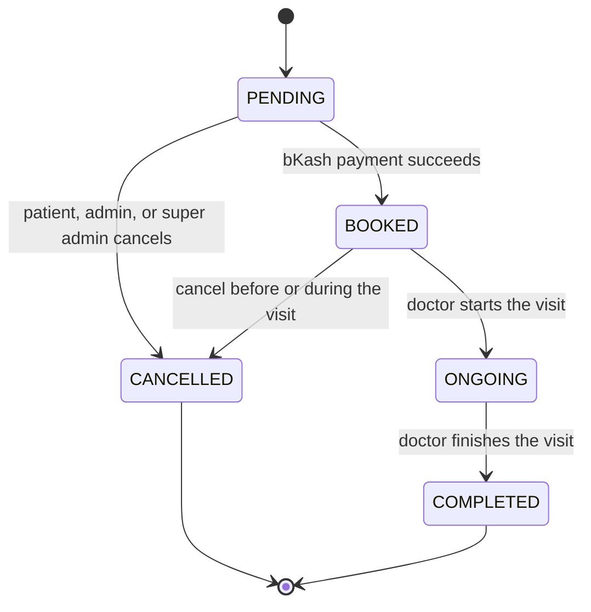
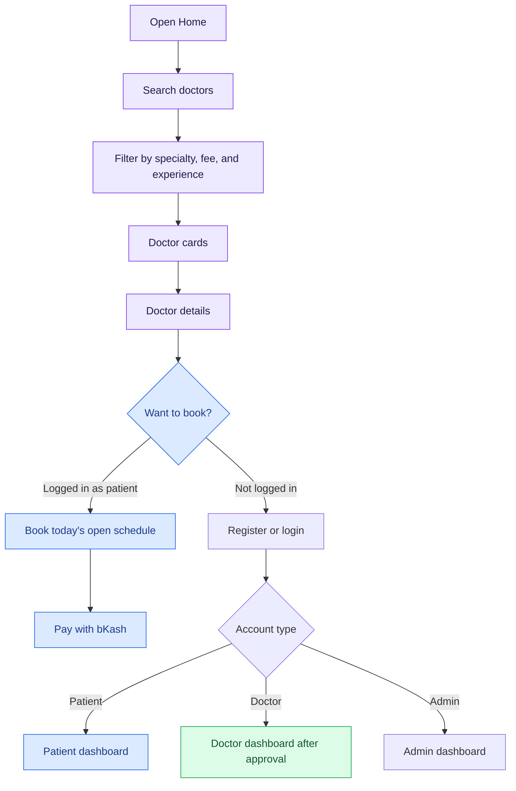
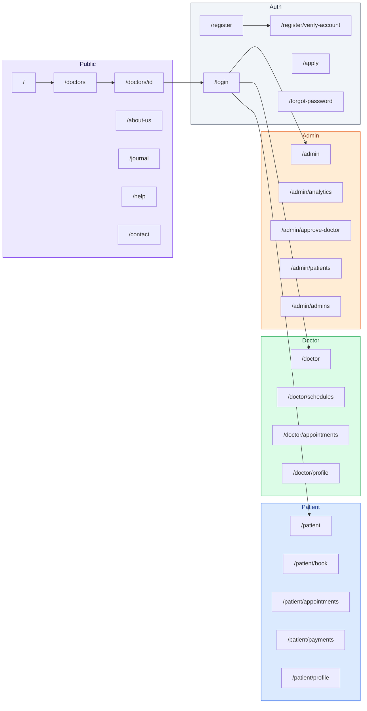

# PH Healthcare — Frontend


---

# PH Healthcare — Full workflow


PH Healthcare is a doctor appointment booking website built around verified doctors. The website has four roles: **patient**, **doctor**, **admin**, and **super admin**.

## 1. Patient

Patients can search for a specific doctor by name, specialty, and fee, choose one they like, book an available time slot, and pay the consultation fee with Stripe or bKash. Right after payment, they receive a payment receipt and a Google Meet link by email, and they use that link to meet the doctor at the time they booked. After the visit, the patient receives the prescription by email and can also view it in their account on the website.

## 2. Doctor

Doctors apply on the website with their resume, certificate, and experience. Once the admin checks the application and approves the doctor, the doctor receives an email saying they were approved, along with their login details. The doctor then signs in and creates their available schedule, so patients can book it. After the visit, the doctor records findings and medicines and submits the prescription.

## 3. Admin and Super Admin

The admin checks every doctor application, including the resume, certificate, and experience. If everything is correct, the admin approves the doctor, and only then can the doctor appear on the website and create a schedule. If anything is wrong, the admin can reject the application or block a patient or doctor. The admin can also see all reviews, payment stats, and analytics with graphs and reports. The super admin has the same powers and can also create, block, and unblock admin accounts.

## Technology

I built it as two separate applications. The frontend uses Next.js and TypeScript, and the backend uses Express with Prisma and PostgreSQL. Authentication uses JWT with role-based access, and I also used Redis and node-cron for background tasks.

[](https://ph-healthcare-six.vercel.app)
[](https://ph-healthcare-api.vercel.app)

PH Healthcare connects patients with approved doctors. A visitor can look through the directory. A **patient** books today's open schedule and pays with bKash. A **doctor** publishes hours and writes the prescription after the visit. An **admin** or **super admin** approves doctors and manages accounts.

Roles: `PATIENT`, `DOCTOR`, `ADMIN`, `SUPER_ADMIN`.

Patients register on the site, with email and password or with Google. Doctors apply and wait for approval. Admins and super admins cannot self-register.

## 1. One-look system flow



A patient can cancel. More than 1 hour before the schedule starts, the payment is refunded. From 1 hour before the start onward, the visit can still be cancelled, without a refund.

## 2. How the four roles meet on one visit



## 3. Appointment status

Payment creates the visit as `PENDING`. It becomes `BOOKED` only after bKash succeeds. `CANCELLED` does not move again.



| Status | Meaning | Who moves it |
| --- | --- | --- |
| `PENDING` | Slot is held. The fee is not paid yet | Created when the patient books |
| `BOOKED` | bKash payment recorded. Serial number assigned | Payment callback |
| `ONGOING` | Consultation has started | Doctor |
| `COMPLETED` | Consultation has finished. A prescription can be written | Doctor |
| `CANCELLED` | Visit closed. Refund only when more than 1 hour remains before the start | Patient, admin, or super admin |

Patients only see **today's published** schedules, and only before that schedule's start time. A schedule with no open slots is hidden.

## 4. Public user flow

Anyone can read the public site without an account.

Pages: `/`, `/doctors`, `/doctors/[doctorId]`, `/about-us`, `/journal`, `/help`, `/contact`, `/privacy`, `/terms`.



The directory calls `GET /api/v1/doctor/all-doctors` with `searchTerm`, `specialization`, `maxFee`, `minExperience`, `sortBy`, `sortOrder`, `page`, and `limit`. Guests only receive doctors who are approved, active, and email-verified.

## 5. Where each role can go

| Step | Visitor | Patient | Doctor | Admin | Super admin |
| --- | :---: | :---: | :---: | :---: | :---: |
| Browse doctors and clinic pages | Yes | Yes | Yes | Yes | Yes |
| Register from the site | Patient, or apply as a doctor | — | — | No | No |
| Book and pay with bKash | No | Yes | No | No | No |
| Cancel a visit | No | Own visit | No | Yes | Yes |
| Publish a 3–8 hour schedule | No | No | Own schedule | No | No |
| Start, finish, and prescribe | No | No | Own visit, after it is completed | No | No |
| Approve or reject a doctor | No | No | No | Yes | Yes |
| Block a doctor or patient | No | No | No | Yes | Yes |
| Create an admin | No | No | No | Yes | Yes |
| Create or block an admin or super admin | No | No | No | No | Yes |

Google sign-in is patient-only. Doctors, admins, and super admins always use email and password.

## 6. Screen map



Open this file in a Markdown preview that supports Mermaid to see the diagrams.

---

## Table of contents

- [Overview](#overview)
- [Live links](#live-links)
- [Tech stack](#tech-stack)
- [Roles and permissions](#roles-and-permissions)
- [Features](#features)
- [Project structure](#project-structure)
- [Getting started](#getting-started)
- [Environment variables](#environment-variables)
- [Routes](#routes)
- [API integration](#api-integration)
- [Payment flow](#payment-flow)

## Overview

PH Healthcare is a **frontend** Next.js application. It talks to a separate Express API. The visit path is:

**Find a doctor → Book today's schedule → Pay with bKash → Attend the serial → Receive a prescription**

The signed-in role decides which dashboard opens. A patient goes to `/patient`, a doctor to `/doctor`, and an admin or super admin to `/admin`. An account that must change its password lands on `/change-password` first. A Google patient who has no password yet is sent to `/patient/profile`.

## Live links

| Resource | Link |
| --- | --- |
| Live frontend | [ph-healthcare-six.vercel.app](https://ph-healthcare-six.vercel.app) |
| Backend API | [ph-healthcare-api.vercel.app](https://ph-healthcare-api.vercel.app) |
| Frontend repo | [github.com/kaziashik/PH-Healthcare-Management-System-Frontend](https://github.com/kaziashik/PH-Healthcare-Management-System-Frontend) |
| Backend repo | [github.com/kaziashik/PH-Healthcare-Backend](https://github.com/kaziashik/PH-Healthcare-Backend) |
| Endpoint list | [`Note/API-Endpoints.md`](./Note/API-Endpoints.md) |
| Longer workflow notes | [`Note/WORKFLOW.md`](./Note/WORKFLOW.md) |

## Tech stack

- **Framework:** Next.js 16 (App Router) and React 19
- **Language:** TypeScript
- **Styling:** Tailwind CSS 4, shadcn / Base UI, Lucide icons
- **Forms and data:** TanStack Form, TanStack Query, Zod 4
- **API client:** ofetch, with the auth cookie sent on each request
- **Sign-in:** Email and password, plus Google for patients
- **Payments:** bKash, handled by the API. This app opens the payment page the API returns
- **Lint:** Biome

Journal, About, Help, Privacy, and Terms are static pages. Doctor lists, login, and the dashboards load their data in the browser. `/doctors/[doctorId]` is rendered when that URL is opened. Details are in [`Note/Rendering-Methods.md`](./Note/Rendering-Methods.md).

## Roles and permissions

| Role | How they join | What they use |
| --- | --- | --- |
| **Patient** | Registers with email and password, or with Google. Email registration needs a 6-digit code | Public pages, booking, bKash payment, appointments, prescriptions, profile |
| **Doctor** | Applies with a resume, verifies email, then waits for approval | Schedules, appointments, prescriptions, profile. Login is email and password only |
| **Admin** | Created by an admin or a super admin. A generated password is emailed to their personal inbox | Doctor approval, patients, admins, analytics |
| **Super admin** | Created by another super admin | Everything an admin can do, plus creating and blocking admins and super admins |

| Action | Admin | Super admin |
| --- | :---: | :---: |
| Approve or reject a doctor | Yes | Yes |
| Block or unblock a doctor or patient | Yes | Yes |
| Create an admin | Yes | Yes |
| Create a super admin | No | Yes |
| Block or unblock an admin or super admin | No | Yes |

## Features

### Public

- Home page with the clinic photo, visit facts, and approved doctors
- Doctor directory with search, specialty, fee, and experience filters
- Doctor page with the portrait, fee, and today's bookable schedule
- About, journal, help, contact, privacy, and terms
- Footer that slides through the clinic photos

### Patient

- Register, verify the email code, and sign in
- Google sign-in on the same patient account, matched by email
- Set a password later if the account started with Google
- Book a published schedule for today, before it starts
- Pay the consultation fee with bKash and receive a 20-minute serial
- See appointments, payments, and the prescription
- Cancel with a refund when more than 1 hour remains before the start

### Doctor

- Apply with qualifications, license number, and a resume
- After approval, create one schedule per calendar day, 3 to 8 hours, with a meeting link
- The schedule starts as draft. Patients see it only after it is published
- The date locks on publish. The time range locks after the first booking
- Mark a visit ongoing, then completed, then write findings and medicines

### Admin and super admin

- Approve or reject doctor applications. A rejection includes a reason
- Block or unblock doctors and patients
- Create admin accounts. A super admin can also create a super admin
- New admin accounts must change the generated password on first login

## Project structure

```text
PH Healthcare Management System Frontend
├── public
│   ├── clinic                         clinic photos
│   ├── doctors                        doctor portraits
│   ├── login.jpg
│   ├── register.jpg
│   └── logo.svg
├── src
│   ├── api                            calls to the Express API
│   ├── app
│   │   ├── (public)
│   │   │   ├── (marketing)            home, doctors, about, journal, help, contact
│   │   │   └── (authentication)       login, register, apply, password reset
│   │   └── (dashboard)
│   │       ├── patient
│   │       ├── doctor
│   │       ├── admin
│   │       └── change-password
│   ├── components
│   │   ├── auth                       login guard and role check
│   │   ├── dashboard                  sidebar
│   │   ├── form                       forms
│   │   ├── layout/public              header and footer
│   │   ├── modules                    page sections
│   │   └── ui                         buttons, inputs, table, toast
│   ├── hooks                          TanStack Query hooks
│   ├── lib                            API client and login redirect
│   ├── providers
│   ├── routes                         sidebar links per role
│   ├── types
│   └── validation                     Zod schemas
├── Note
│   ├── API-Endpoints.md
│   ├── WORKFLOW.md
│   ├── Rendering-Methods.md
│   └── Project Requirements.md
├── presentation-poster.png
├── .env.local                         local API URL, not committed
├── package.json
└── next.config.ts
```

`node_modules`, `.next`, and `.vercel` are created on your machine. They are not source.

Route groups `(public)`, `(marketing)`, `(authentication)`, and `(dashboard)` share a layout without adding a segment to the URL.

## Getting started

### Prerequisites

- Node.js 20 or newer
- npm
- The [backend API](https://ph-healthcare-api.vercel.app), running locally or deployed

### Installation

```bash
git clone https://github.com/kaziashik/PH-Healthcare-Management-System-Frontend.git
cd PH-Healthcare-Management-System-Frontend
npm install
```

### Configure environment variables

Create `.env.local` in this folder. Names only — do not commit real values.

```dotenv
NEXT_PUBLIC_API_BASE_URL=http://localhost:5000/api/v1
NEXT_PUBLIC_GOOGLE_CLIENT_ID=
NEXT_PUBLIC_FACEBOOK_APP_ID=
```

### Run the dev server

```bash
npm run dev
```

Visit **http://localhost:3000**.

### Scripts

| Command | What it does |
| --- | --- |
| `npm run dev` | Starts the app and reloads when you save a file |
| `npm run build` | Creates the production build |
| `npm run start` | Serves the production build. Run `npm run build` first |
| `npm run lint` | Checks the code with Biome |
| `npm run format` | Formats the code with Biome |

## Environment variables

| Variable | Scope | Used for |
| --- | --- | --- |
| `NEXT_PUBLIC_API_BASE_URL` | Browser | Express API base URL, including `/api/v1` |
| `NEXT_PUBLIC_GOOGLE_CLIENT_ID` | Browser | Shows the Google sign-in button. Leave it empty to hide that login |
| `NEXT_PUBLIC_FACEBOOK_APP_ID` | Browser | Reserved for Facebook sign-in. Leave it empty. Facebook stays off until app credentials exist |

For the deployed API:

```dotenv
NEXT_PUBLIC_API_BASE_URL=https://ph-healthcare-api.vercel.app/api/v1
```

Restart `npm run dev` after changing `.env.local`.

## Routes

| Next.js route | Who | API it uses |
| --- | --- | --- |
| `/` | Everyone | `GET /doctor/all-doctors` |
| `/doctors` | Everyone | `GET /doctor/all-doctors` |
| `/doctors/[doctorId]` | Everyone | `GET /doctor/:doctorId`, `GET /schedule/todays-schedule` |
| `/about-us`, `/journal`, `/help`, `/privacy`, `/terms` | Everyone | Static pages |
| `/contact` | Everyone | `POST /contact` |
| `/register` | Guest | `POST /auth/register` |
| `/register/verify-account` | Guest | `POST /auth/verify-email` |
| `/login` | Guest | `POST /auth/login`, `POST /auth/google` |
| `/forgot-password` | Guest | `POST /auth/forgot-password` |
| `/reset-password` | Guest | `POST /auth/reset-password` |
| `/apply` | Guest | `POST /doctor/apply-as-doctor`, then `POST /doctor/apply-as-doctor/verify-email` |
| `/patient` | Patient | `GET /auth/me` |
| `/patient/book` | Patient | `GET /schedule/todays-schedule`, `POST /appointment/book-appointment` |
| `/patient/appointments` | Patient | `GET /appointment/my-appointments`, `POST /appointment/pay-appointment`, `POST /appointment/cancel-appointment` |
| `/patient/payments` | Patient | `GET /payment/my-payments` |
| `/patient/profile` | Patient | `POST /auth/set-password`, `PATCH /user/profile-image` |
| `/doctor` | Doctor | `GET /auth/me` |
| `/doctor/schedules` | Doctor | `GET /schedule/my-schedules`, `POST /schedule/create-schedule`, `PATCH /schedule/publish-schedule/:scheduleId` |
| `/doctor/appointments` | Doctor | `GET /appointment/doctor-appointments`, `PATCH /appointment/update-status/:appointmentId`, `POST /prescription/create-prescription` |
| `/doctor/profile` | Doctor | `PATCH /doctor/update-my-profile` |
| `/admin` | Admin, super admin | Dashboard home |
| `/admin/analytics` | Admin, super admin | Clinic counts |
| `/admin/approve-doctor` | Admin, super admin | `POST /doctor/approve-doctor` |
| `/admin/patients` | Admin, super admin | `GET /user/patients`, `PATCH /user/account-status` |
| `/admin/admins` | Admin, super admin | `GET /user/admins`, `POST /user/create-admin`, `POST /user/create-super-admin` |
| `/change-password` | Signed-in user | `POST /auth/change-password` |

Paths above are relative to `https://ph-healthcare-api.vercel.app/api/v1`. The full list, including query fields, is in [`Note/API-Endpoints.md`](./Note/API-Endpoints.md).

## API integration

The browser calls the API through `src/lib/apiClient.ts`. The cookie is included, so a signed-in request does not attach a token by hand.

| Area | Files |
| --- | --- |
| Auth | `src/api/auth.api.ts` |
| Doctors | `src/api/doctor.api.ts` |
| Schedules | `src/api/schedule.api.ts` |
| Appointments | `src/api/appointment.api.ts` |
| Accounts | `src/api/user.api.ts` |
| Contact | `src/api/contact.api.ts` |

Each API file has a matching hook in `src/hooks`.

## Payment flow

Booking and payment are two steps.

```text
Patient picks today's open schedule
        ↓
POST /appointment/book-appointment
        ↓
Appointment = PENDING
        ↓
POST /appointment/pay-appointment
        ↓
bKash payment page
        ↓
GET /appointment/book-appointment/payment/callback
        ↓
Appointment = BOOKED
Serial = next 20-minute slot
Invoice emailed to the patient
```

The schedule must be published, on today's date, and still before its start time. One schedule belongs to one doctor and one calendar date. Its length is 3 to 8 hours, split into 20-minute slots.

### Refund rule

| When the visit is cancelled | Refund |
| --- | --- |
| More than 1 hour before the schedule starts | Yes |
| From 1 hour before the start, through the visit, or after it ends | No. The visit is still cancelled |

Example: a schedule runs 3:00 PM–9:00 PM. Cancelling before 2:00 PM refunds the payment. Cancelling from 2:00 PM onward cancels the visit without a refund.

### After the visit

```text
BOOKED
  ↓  doctor starts
ONGOING
  ↓  doctor finishes
COMPLETED
  ↓  findings and at least one medicine
Prescription PDF emailed to the patient
```

A prescription cannot be written before the visit is `COMPLETED`.
