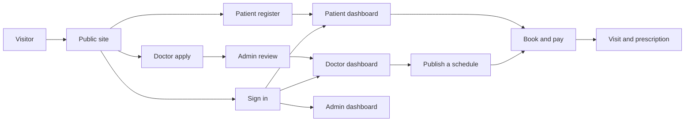

# PH Healthcare — Frontend


Patient, doctor, and admin web app for same-day clinic visits. A visitor finds an approved doctor, a patient pays the consultation fee with bKash, and the clinic assigns a 20-minute serial. Doctors publish schedules and write prescriptions. Admins approve doctor applications.

| | |
| --- | --- |
| Live site | https://ph-healthcare-six.vercel.app |
| API | https://ph-healthcare-api.vercel.app |
| Local app | http://localhost:3000 |
| Local API | http://localhost:5000/api/v1 |

This folder is the Next.js frontend only. The Express API lives in `PH Healthcare Management System Backend`. The site does not work fully until that API is running and `NEXT_PUBLIC_API_BASE_URL` points at it.

Longer notes are in the `Note` folder: workflow diagrams, rendering methods, and the original build plan.

## Technologies

| Technology | Role in this app |
| --- | --- |
| Next.js 16 (App Router) | Routes, layouts, and the production build |
| React 19 | UI components |
| TypeScript | Types for pages, API data, and forms |
| Tailwind CSS 4 | Layout, spacing, color, light and dark theme |
| shadcn / Base UI | Buttons, inputs, tables, sheets, and the sidebar |
| TanStack Query | Loads doctors, appointments, and the signed-in user in the browser |
| TanStack Form | Login, register, doctor apply, schedules, and prescriptions |
| Zod 4 | Checks form values before they are sent |
| ofetch | Calls the API and sends the session cookie |
| Lucide | Icons |
| Biome | Lint and format |
| React Compiler | Enabled in `next.config.ts` |

Pages such as Journal and About are static HTML. Doctor lists, login, and the dashboards load their data in the browser. `/doctors/[doctorId]` is rendered when that URL is opened. Details are in `Note/Rendering-Methods.md`.

## What you need installed

| Tool | Version | Used for |
| --- | --- | --- |
| Node.js | 20 or newer | Runs Next.js |
| npm | Comes with Node.js | Installs packages and starts the app |

Bun 1.3 is listed in `package.json` as an optional package manager. The commands below use npm.

The backend also needs PostgreSQL, and its own `.env`, before login and booking work. Start that server on port `5000` first.

## Setup

From this folder:

```bash
npm install
```

`npm install` reads `package.json` and installs every package in the tables below. You do not install them one by one.

Create `.env.local` in this folder:

```bash
NEXT_PUBLIC_API_BASE_URL=http://localhost:5000/api/v1
NEXT_PUBLIC_GOOGLE_CLIENT_ID=
NEXT_PUBLIC_FACEBOOK_APP_ID=
```

| Variable | Required | What it does |
| --- | --- | --- |
| `NEXT_PUBLIC_API_BASE_URL` | Yes | Address of the Express API, including `/api/v1` |
| `NEXT_PUBLIC_GOOGLE_CLIENT_ID` | No | Turns on the Google sign-in button. Leave it empty to hide that login |
| `NEXT_PUBLIC_FACEBOOK_APP_ID` | No | Turns on Facebook sign-in. Leave it empty and the button tells the visitor that Facebook is not configured |

For the live API instead of a local one:

```bash
NEXT_PUBLIC_API_BASE_URL=https://ph-healthcare-api.vercel.app/api/v1
```

Restart `npm run dev` after you change `.env.local`.

## Scripts

| Command | What it does |
| --- | --- |
| `npm run dev` | Starts the app at http://localhost:3000 and reloads when you save a file |
| `npm run build` | Creates the production build |
| `npm run start` | Serves the production build. Run `npm run build` first |
| `npm run lint` | Checks the code with Biome |
| `npm run format` | Formats the code with Biome |

## Dependencies

These are installed by `npm install`. Versions are the ranges in `package.json`.

### Runtime

| Package | Why it is here |
| --- | --- |
| `next` | App framework and router |
| `react`, `react-dom` | UI |
| `@tanstack/react-query` | Server data in client components |
| `@tanstack/react-form` | Forms |
| `zod` | Validation |
| `ofetch` | HTTP client (`src/lib/apiClient.ts`) |
| `@base-ui/react` | Accessible primitives used by the UI kit |
| `shadcn` | UI component setup |
| `class-variance-authority` | Button and component variants |
| `cn` | Class name helper |
| `lucide-react` | Icons |
| `input-otp` | Email verification code field |
| `@react-oauth/google` | Google sign-in |
| `tw-animate-css` | Small motion utilities used with Tailwind |

### Development

| Package | Why it is here |
| --- | --- |
| `typescript` | Typecheck during `next build` |
| `tailwindcss`, `@tailwindcss/postcss` | Styles |
| `@biomejs/biome` | `npm run lint` and `npm run format` |
| `@types/node`, `@types/react`, `@types/react-dom` | Type packages |
| `babel-plugin-react-compiler` | React Compiler used by Next.js |

## Workflow

Four roles share one site. After sign-in, a patient opens `/patient`, a doctor opens `/doctor`, and an admin or super admin opens `/admin`. If the account must change its password, the first page is `/change-password`. A Google patient with no password is sent to `/patient/profile`.



| Who | What they do |
| --- | --- |
| Visitor | Reads the public pages, searches doctors, or sends a contact message. Contact is not a booking |
| Patient | Registers, verifies email, pays the consultation fee with bKash, gets a 20-minute serial, and can open the prescription |
| Doctor | Applies with a resume, verifies email, waits for approval, publishes a 3 to 8 hour schedule, then writes the prescription |
| Admin | Reads clinic counts and approves or rejects doctors. Rejection needs a reason |
| Super admin | Does the admin work, and can also create or block an admin |

Booking rules that the UI follows:

- Only an approved, email-verified doctor appears in the directory.
- A patient can book a published schedule on the same calendar day, before it starts.
- Payment success marks the visit booked and assigns the next 20-minute serial.
- Cancel more than 1 hour before the start time to receive a bKash refund.

The full flowcharts and sequence diagrams are in `Note/WORKFLOW.md`.

## Routes

| Path | Who | Page |
| --- | --- | --- |
| `/` | Everyone | Home |
| `/doctors`, `/doctors/[doctorId]` | Everyone | Directory and one doctor |
| `/about-us`, `/journal`, `/help`, `/contact`, `/privacy`, `/terms` | Everyone | Clinic pages |
| `/login`, `/register`, `/register/verify-account` | Guest | Sign in, register, email code |
| `/forgot-password`, `/reset-password`, `/apply` | Guest | Password reset and doctor application |
| `/patient`, `/patient/book`, `/patient/appointments`, `/patient/payments`, `/patient/profile` | Patient | Dashboard |
| `/doctor`, `/doctor/schedules`, `/doctor/appointments`, `/doctor/profile` | Doctor | Dashboard |
| `/admin`, `/admin/analytics`, `/admin/approve-doctor`, `/admin/patients`, `/admin/admins` | Admin | Dashboard |
| `/change-password` | Signed-in user | Required password change |

## Folder structure

`node_modules`, `.next`, and `.vercel` are created on your machine. They are not source.

```text
PH Healthcare Management System Frontend
├── public
│   ├── clinic                         hospital photos for the home page and footer
│   ├── doctors                        portrait photos used on doctor cards
│   ├── login.jpg
│   ├── register.jpg
│   └── logo.svg
├── src
│   ├── api                            functions that call the Express API
│   │   ├── auth.api.ts
│   │   ├── doctor.api.ts
│   │   ├── appointment.api.ts
│   │   ├── schedule.api.ts
│   │   ├── user.api.ts
│   │   └── contact.api.ts
│   ├── app
│   │   ├── layout.tsx                 root layout and providers
│   │   ├── globals.css                theme, card style, footer animation
│   │   ├── (public)
│   │   │   ├── (marketing)            home, doctors, about, journal, help, contact
│   │   │   └── (authentication)       login, register, apply, password reset
│   │   └── (dashboard)
│   │       ├── patient
│   │       ├── doctor
│   │       ├── admin
│   │       └── change-password
│   ├── components
│   │   ├── auth                       login guard and role check
│   │   ├── dashboard                  sidebar and account menu
│   │   ├── form                       every form in the app
│   │   ├── layout/public              header and footer
│   │   ├── modules                    page sections, one folder per feature
│   │   ├── theme                      light and dark toggle
│   │   └── ui                         shared buttons, inputs, table, toast
│   ├── hooks                          TanStack Query hooks
│   ├── lib                            API client, login redirect, demo accounts
│   ├── providers                      Query client and Google provider
│   ├── routes                         sidebar links per role
│   ├── types                          API response types
│   ├── utils
│   └── validation                     Zod schemas shared with the forms
├── Note
│   ├── WORKFLOW.md                    flowcharts and sequence diagrams
│   ├── Rendering-Methods.md           SSG, SSR, ISR, and CSR in this app
│   ├── RENDERING.md
│   ├── Folder_stacter.md
│   ├── FRONTEND_BUILD_PLAN.md
│   └── Project Requirements.md
├── .env.local                         your local API URL, not committed
├── biome.json
├── components.json
├── next.config.ts
├── package.json
├── postcss.config.mjs
└── tsconfig.json
```

A file-by-file tree is in `Note/Folder_stacter.md`.

## Where to change things

| Task | Start here |
| --- | --- |
| Change a public page | `src/app/(public)/(marketing)` and `src/components/modules` |
| Change a form | `src/components/form` and `src/validation` |
| Change an API call | `src/api`, then the matching file in `src/hooks` |
| Change where login sends each role | `src/lib/auth-redirect.ts` |
| Change colors, radius, or the card style | `src/app/globals.css` |
| Add a sidebar link | `src/routes` |
